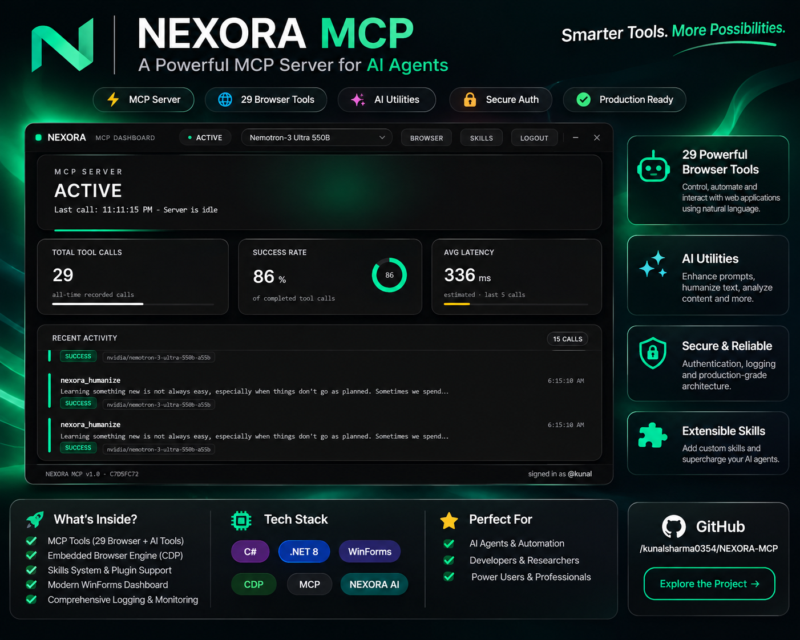

# NEXORA MCP



Windows desktop application that doubles as a Model Context Protocol (MCP) server, integrating the NEXORA AI platform (`nexora-navy-omega.vercel.app`) with AI coding assistants such as OpenCode.

One executable, two modes:

- **GUI mode** (default launch) - WinForms dashboard with an embedded WebView2 browser, network inspector and skills manager.
- **MCP server mode** (`--mcp`) - stdio MCP server exposing 36 tools to any MCP client.

---

## Highlights

- **36 MCP tools** in four groups: AI prompt enhancement, AI text humanization, HTTP network logging and a full embedded-browser automation suite.
- **AI Humanizer** with a rewrite pipeline validated live against a statistical AI detector (ZeroGPT): input texts scoring 100% "AI-generated" consistently drop to 0% after the medium/heavy pipeline.
- **Skills library** with 27 built-in engineering skills exposed as MCP tools (`nexora_skills_*`) and shipped next to the executable.
- **DevTools-style network log** that records every outbound HTTP call the app and its MCP tools make, persisted to disk.
- **Hot-reloading auth**: the session token is re-read from disk on every tool call, so a fresh login in the app is picked up by running MCP clients without restart. Invalid tokens (401) self-heal on the next call.

---

## MCP Tool Reference

### AI

| Tool | Description |
|---|---|
| `nexora_enhance_prompt` | Transforms a vague user request into a detailed, execution-ready prompt through the NEXORA AI endpoint. |
| `nexora_humanize` | Rewrites AI-sounding text so it reads like a real person wrote it. Intensities: `light` (rewrite + QA), `medium` (rewrite + redraft + QA), `heavy` (rewrite + two redrafts + QA). Preserves meaning and length; a local scan gate (`HumanizeScan`) blocks residual AI tells and drives automatic fix passes. |

### Network

| Tool | Description |
|---|---|
| `nexora_network_log` | Reads the DevTools-style HTTP log: recent requests with URL, method, status code, duration and byte counts. Backed by `NetworkLog` (ring buffer) persisting to `%LocalAppData%\Nexora\network_log.json`. |

### Embedded browser (29 tools)

| Tool | Description |
|---|---|
| `nexora_browser_status` | Browser running state, active page URL/title, tab count, proxy, profile path. |
| `nexora_browser_launch` | Start the shared embedded WebView2 browser. |
| `nexora_browser_navigate` | Navigate the active tab to a URL. |
| `nexora_browser_get_content` | Extract readable text from the current page. |
| `nexora_browser_screenshot` | Capture the current page to an image file. |
| `nexora_browser_click` / `nexora_browser_click_at` | Click an element by selector or screen coordinates. |
| `nexora_browser_fill` / `nexora_browser_type` | Fill a form field by selector / type text into the focused element. |
| `nexora_browser_press_key` | Send a key or key chord. |
| `nexora_browser_wait_for` | Wait for an element or text to appear. |
| `nexora_browser_evaluate` | Run JavaScript in the page context. |
| `nexora_browser_snapshot` | Structured accessibility snapshot of the page. |
| `nexora_browser_console` | Buffered console messages and page errors. |
| `nexora_browser_get_tabs` / `nexora_browser_open_tab` / `nexora_browser_switch_tab` / `nexora_browser_close_tab` | Multi-tab management. |
| `nexora_browser_go_back` / `nexora_browser_go_forward` / `nexora_browser_reload` | Navigation history. |
| `nexora_browser_set_viewport` / `nexora_browser_set_proxy` | Viewport sizing and session proxy. |
| `nexora_browser_hover_at` / `nexora_browser_scroll` / `nexora_browser_drag` | Pointer movement, scrolling and drag-and-drop. |
| `nexora_browser_upload` | Push a local file into a page file input. |
| `nexora_browser_select_option` | Choose an option in a dropdown. |
| `nexora_browser_close` | Close/reset the embedded browser. |

### Skills (4 tools)

| Tool | Description |
|---|---|
| `nexora_skills_search` | Search the 27-skill library by keyword. |
| `nexora_skills_load` | Load a skill's full instructions into the agent context. |
| `nexora_skills_details` | Skill metadata: description, tags, source paths. |
| `nexora_skills_plan` | Suggest which skills to apply for a given task description. |

---

## Built-in Skills Library

The `NEXORA MCP/skills/` folder ships 27 engineering skills (each `skills/<id>/` holds `manifest.json` + `SKILL.md`, copied next to the executable at build time):

`accessibility-inclusive-ui`, `ai-agent-workflow-orchestration`, `ai-project-context`, `api-integration-resilience`, `backend-api-engineering`, `backend-development`, `browser-automation-verification`, `bug-fixing-minimal-diff`, `code-review-and-refactoring`, `database-and-migrations`, `database-engineering`, `debugging-root-cause`, `devops-release-readiness`, `frontend-development`, `frontend-react-engineering`, `mcp-server-engineering`, `performance-and-efficiency`, `prompt-specification-engineering`, `release-and-change-management`, `requirements-and-planning`, `security-review`, `technical-documentation`, `testing-quality-assurance`, `ui-ux-design`, `ui-ux-design-system`, `web-application-engineering`, `web-development`

Run `NEXORA MCP.exe --skills-check` for a self-check of the registry (prints PASS/FAIL details and exits 0/1).

---

## Getting Started

### Prerequisites

- Windows 10/11
- .NET 8 SDK
- An active NEXORA account (used through the app's login screen)

### Build

```powershell
dotnet build -c Release
```

Output: `NEXORA MCP/bin/Release/net8.0-windows/NEXORA MCP.exe`

### Sign in

Launch the executable without arguments, open the login screen and sign in to your NEXORA account. The session token is persisted to:

```
%LocalAppData%\Nexora\session.json
```

### Register with OpenCode

Add a `local` MCP server entry in `~/.config/opencode/opencode.json`:

```json
{
  "mcp": {
    "nexora": {
      "type": "local",
      "command": [
        "C:\\path\\to\\NEXORA MCP.exe",
        "--mcp"
      ],
      "enabled": true
    }
  }
}
```

Any MCP client that speaks stdio works the same way. When OpenCode is detected the app can also self-register on first `--mcp` launch.

---

## Architecture

| Path | Role |
|---|---|
| `NEXORA MCP/Program.cs` | Entry point: `--mcp` server mode, `--skills-check`, GUI mode. Hosts the `nexora_enhance_prompt` tool. |
| `NEXORA MCP/AuthService.cs` | Login flow against the NEXORA backend; robust token-expiry parsing. |
| `NEXORA MCP/TokenStore.cs` | Cross-process token store with hot-reload (`EnsureFresh`) and in-memory invalidation on 401. |
| `NEXORA MCP/NexoraAiClient.cs` | NEXORA `/api/ai` client: prompt enhancement plus the multi-pass humanize pipeline. |
| `NEXORA MCP/HumanizeScan.cs` | Local QA scan (in-process, no network) - AI-favorite word lists, cliche templates, dash/semicolon rules, sentence-rhythm variance, length-drift check. |
| `NEXORA MCP/HumanizeTool.cs` | MCP tool registration for `nexora_humanize`. |
| `NEXORA MCP/NetworkLog.cs` | Outbound HTTP ring-buffer logger with disk persistence. |
| `NEXORA MCP/NetworkTool.cs` | MCP tool registration for `nexora_network_log`. |
| `NEXORA MCP/NexoraBrowserTool.cs` | The 29-tool embedded browser automation suite (WebView2). |
| `NEXORA MCP/SkillsRegistry.cs` / `SkillsCheck.cs` / `SkillsTool.cs` | File-based skills registry, self-check and MCP tools. |
| `NEXORA MCP/BrowserChrome.cs` | WebView2 UI chrome for the GUI dashboard. |
| `NEXORA MCP/WebDashboardForm.cs` | Web dashboard host. |
| `NEXORA MCP/web/` | Next.js dashboard sources. |
| `NEXORA MCP/skills/` | 27 built-in skills (manifest + SKILL.md each). |
| `sysprompot.txt` | System prompt used by `nexora_enhance_prompt`. |
| `sysprompt-humanize.txt` | Earlier humanizer system prompt (kept for reference); the active validated rewrite recipe lives in `NexoraAiClient.cs`. |
| `NEXORA_AI_API_Integration.md` | API integration notes. |
| `brain.md` | Working project notes and tool reference. |

### Runtime data (never committed)

| Path | Contents |
|---|---|
| `%LocalAppData%\Nexora\session.json` | Login session token. |
| `%LocalAppData%\Nexora\network_log.json` | HTTP request log. |
| `%LocalAppData%\Nexora\mcp_activity.json` | Tool-call audit trail. |
| `%LocalAppData%\Temp\nexora-skills-check.log` | Skills self-check output. |

### Security notes

- No credentials are hardcoded; the auth token lives only in `%LocalAppData%` and is loaded per call.
- `sysprompt-humanize.txt`, `sysprompt-humanize` fallbacks and the rewrite recipe contain no account data.
- The repository is periodically scanned for leaked tokens before committing.

---

## Documentation

- `NEXORA_AI_API_Integration.md` - NEXORA AI endpoint contract and usage notes.
- `brain.md` - ongoing engineering notes, tool matrix and runtime folder details.

---

## Credits and Copyright

Built as a personal production tool around the NEXORA AI platform. All rights reserved.
